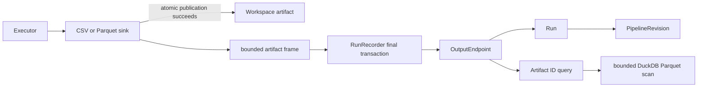

# Artifact governance and DuckDB query design

Status: local implementation on `feature/28-parquet-artifact-query`; independent
review, hosted CI, PR approval and merge remain pending.

## Publication and provenance

The sink constructs metadata before publication but emits it only after the
temporary file is completely written, flushed and atomically published.
`RunRecorder.finish` accepts metadata only from completed production
`sink.csv` and `sink.parquet` nodes and writes it in the run's final SQLite
transaction. The unique `(run_id, node_id, name)` constraint prevents duplicate
links. Every endpoint therefore identifies its producing run; the run already
references the exact immutable pipeline revision and owning pipeline/project.

The database stores a logical relative resource reference, declared SDK schema
and row count, not an absolute path or file contents. Migration `0003` backfills
pre-governance rows with an explicit unknown schema and preserves them for
metadata lookup. Unknown-schema legacy rows cannot be queried.

## Query policy and resource bounds

The public operation is a typed projection plus offset and limit. There is no
arbitrary-SQL API. The artifact ID is resolved in SQLite first; only registered
Parquet format proceeds. Requested columns must exist in the registered schema
and are escaped as SQL identifiers. The resolved path comes only from the
stored logical reference, the producing run's project folder and the existing
workspace containment policy, so a query reads exactly the file the sink
published under `<workspace>/<project id>/`. The path, limit and offset are
bound parameters.

Each request creates and closes one in-memory DuckDB connection. It uses one
thread, a 64 MB memory limit and disabled insertion-order preservation. SQL has
an enforced `LIMIT limit + 1`, so only a bounded look-ahead reaches Python.
The service permits at most 500 returned rows, 100 columns and 50,100 fetched
cells. Projection and limit are pushed into DuckDB; Python never loads the
whole Parquet file or creates an unbounded duplicate table.

## PyArrow and DuckDB boundary

PyArrow remains the sink serialization boundary. It maps SDK `string`,
`integer`, `number` and `boolean` to Arrow string, int64, float64 and bool while
preserving column order and declared nullability. DuckDB is the read/query
boundary and scans the published Parquet file directly. Only bounded scalar
rows cross back into Python; strings, integers, finite floats, booleans and
nulls are accepted. Other values fail closed.

The metadata link verifies origin and declared structure, not cryptographic
content identity. External modification of files inside the private workspace
is outside this story's trust boundary; deployment permissions must prevent it.

## Failure behavior

- Failed or skipped sinks create no `OutputEndpoint`.
- A completed sink with malformed metadata makes final registration fail
  atomically rather than persisting a partial endpoint.
- Missing/unregistered artifacts return safe not-found or unavailable errors.
- CSV and unknown-schema legacy artifacts remain discoverable but not queryable.
- Traversal, absolute paths and paths outside the configured root are rejected
  by the shared file-resource policy.

See [usage](../artifacts.md) and
[acceptance mapping](../testing/issue-28-artifact-query.md).
