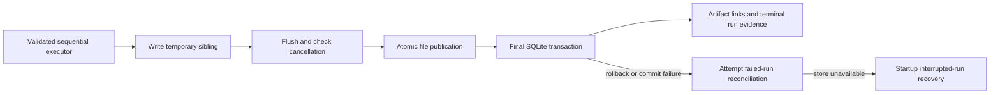

# Execution failure and recovery (#34)

Local implementation on `feature/34-stabilize-execution-failures-and-output-cleanup`,
based on `cc5ebdf`. This design implements the user-approved hardening plan.
Independent review, hosted CI, merge and stakeholder acceptance remain pending.

## Failure boundaries

Failure skips transitive dependents; independent branches continue. Node states
and executor failures remain authoritative even when an SDK success event precedes
an adapter or retained-data-budget failure. Successful branch outputs survive
failure elsewhere, including a completed sink's registered artifact. This is
per-sink publication, not a pipeline-wide transaction or rollback protocol.

The file sink checks cancellation before writing, after writing and after flush,
immediately before atomic publication. Cancellation observed at these checkpoints
fails the sink without replacing a previous target or returning artifact metadata.
Cancellation is cooperative: a request arriving after the last checkpoint may
race with publication. Once publication succeeds, its side effect is final.
There is no post-publication cancellation check that falsely revokes that success.

Temporary-file deletion is attempted once. An operating-system deletion failure
logs a bounded message with exception type, run and node identifiers, without the
private path or exception text. It cannot mask a write/cancellation/interruption
failure or turn a completed publication into a failed write. A failed deletion
may leave a `.lps-*.tmp` sibling for operator cleanup.

## Persistence and recovery

`RunRecorder` updates its created flag only after transaction commit and restores
event sequence bookkeeping after rollback. Timing marks describe actual execution
and remain independent of persistence success. Final block evidence, registered
artifacts and run outcome still commit in one SQLite transaction.

`execute_revision` handles errors from execution and final reconciliation. An
unexpected failure attempts a fresh transaction marking an existing run failed
with `execution_failed`; recovery failure is logged by type without replacing the
primary exception. If SQLite remains unavailable, startup's existing
`recover_interrupted` closes queued/running records as failed with `interrupted`.
Invalid pipelines still create no run. No success outcome returns before commit.

SQLite and the filesystem are separate transactions. A crash, finalization
failure, failed after-execute hook or executor budget failure after publication
can leave a complete file without a registered output. Recovery never infers
success from file existence and never deletes a committed target. Explicit
`overwrite=replace` reuses a logical path, so earlier artifact metadata does not
guarantee historical immutable bytes. Immutable artifact storage and automatic
retries would require a separate design.

## Timer drain and database ownership

The scheduler serializes drain admission with starts. During a drain, both
replacement and unrelated timer starts receive `409 timer_scheduler_draining`.
All workers receive stop/cancellation signals before any join. Joins share one
monotonic deadline (30 seconds by default), rather than one timeout per timer.
Entries are removed only after their workers exit. Concurrent drains are rejected.

An incomplete drain raises `TimerShutdownTimedOut` with the unfinished pipeline
identifiers. Live workers remain owned and starts stay blocked until they finish.
The caller can retry draining; a later start also reclaims a fully exited drain.
Only successful drain permits database disposal. Application shutdown logs its
incomplete status and retains the scheduler/database handles when the deadline
expires, rather than closing a database still needed by workers.

Python threads cannot forcibly stop arbitrary native I/O. The deadline bounds
waiting, not guaranteed resource release by uncooperative code. Process exit
reclaims process resources; interrupted runs recover on next startup. A hard
execution/cleanup guarantee would require process isolation, outside this scope.
Manual execution is not serialized against timers by this change; the existing
single-timer no-overlap guarantee is preserved, not expanded to every caller.

## Alternatives and compatibility

- Keep the existing sequential executor, SDK and metadata schema: their contracts
  already support the issue. Regression tests establish behavior without a new
  scheduling framework, migration, dependency or portable-definition change.
- Preserve completed branches instead of rolling back every sink: a run-wide
  transaction would require staged publication and recovery across multiple files.
- Reject unsafe shutdown instead of waiting forever or disposing a live database:
  this bounds the caller's wait while retaining truthful ownership.
- Preserve `overwrite=error` and explicit replacement. Never auto-delete existing
  targets or scan workspaces to delete files with uncertain ownership.

See [operator recovery](../execution.md#failure-recovery-34) and
[acceptance evidence](../testing/issue-34-execution-failures.md).
