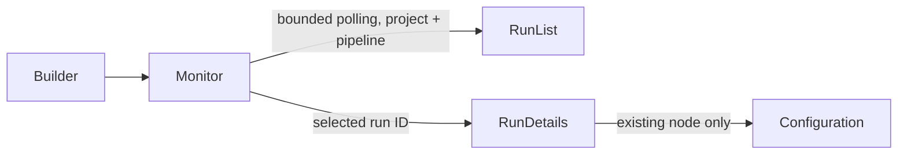

# Run monitoring (#30)

## Design and boundaries

The Builder monitors persisted runs for its open, saved pipeline. The existing
execute API and timer scheduler create runs; execution controls and the combined
author/preview/execute flow remain #31. Dependencies #15, #27 and #29 are merged.

TanStack Query keys include project, pipeline and run identity. Requests consume
AbortSignals, validate response identities, and never use previous-run placeholder
data. The newest run is selected initially; an explicit selection stays pinned
when new runs arrive. Only the newest 20 runs and latest 100 events are displayed.
Inactive queries are immediately collected, avoiding accumulation across runs.
The list polls every two seconds while visible; details stop polling at a terminal
state. Focus/reconnect and a manual refresh recover transient errors. Retained
data is explicitly marked stale on request failure. Unknown measurements render
as “Unknown”; succeeded is presented as “Completed”.

Server telemetry is already redacted before persistence (#27). The UI renders
plain text, never HTML, and does not fetch source data or exception payloads.
The log is keyboard-scrollable and bounded. Error navigation selects an existing
node's configuration without replacing graph data; removed nodes have no active
link. Historical revision labels warn that configuration may have changed.

Alternatives: streaming adds infrastructure beyond the requirement; copying run
state into graph nodes risks persisting execution state into authored definitions.
A separate evidence panel preserves that boundary. No backend/schema/dependency
changes are needed.

## Operator workflow

Save/open a pipeline to show Run monitoring. Runs started by the execute API or
timer appear automatically. Select a run to inspect its ID, saved revision,
status, duration, counts, blocks and redacted events. “Inspect” opens the matching
block configuration; check its resource/configuration against the reported error
before saving and rerunning. Refresh retries telemetry reads only.

No runs, loading, disconnection, missing historical nodes and empty logs have
explicit messages. Only the latest 20 runs are available in this bounded panel;
older history remains available through the API. No stakeholder acceptance or
independent review is implied.
