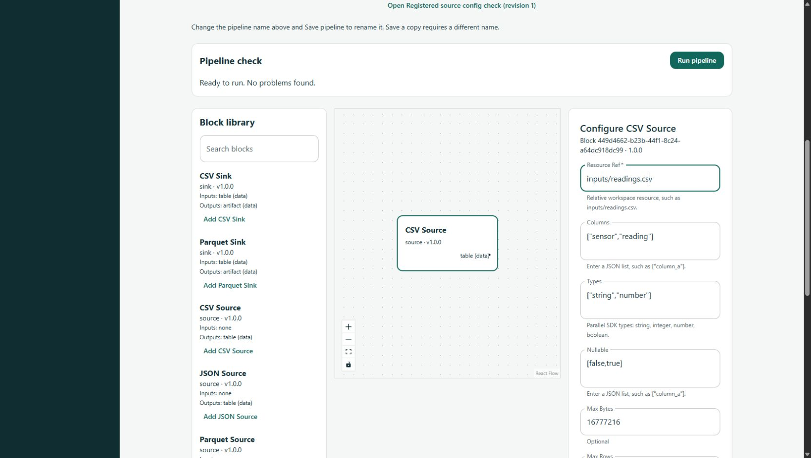

# Iteration 2 file-block verification

Scope: #16 sources, #18 transforms, #20 sinks. Base revision:
`ef3adb8624604fbc5432651a886e735ed9e40b81`. Branch: `feature/16-file-blocks`.
Verification date: October 21, 2026. All records below are actual Codex executions
directed by Yousef. Independent teammate review and stakeholder acceptance are
pending; the historical issue owners remain assigned.

## Acceptance evidence

| Requirement | State | Evidence |
|---|---|---|
| Three registered, bounded file sources and explicit schemas | PASS locally | `tests/test_file_blocks.py`, `tests/test_file_policy.py`; actual CSV/JSON/Parquet SDK invocations |
| Encodings, malformed/empty/null/unsupported inputs | PASS locally | Latin-1 and UTF-8 BOM, malformed JSON/CSV, duplicate keys/headers, nested values, missing/unreadable files, empty JSON explicit schema and header-only CSV |
| Workspace paths and resource limits | PASS locally; symlink creation unavailable on host | traversal/absolute/device paths, outside-workspace resolver, byte/row/column/cell limits and exact boundary; real symlink case requires Linux CI |
| Four transforms and golden schemas/rows | PASS locally | `tests/test_transform_blocks.py`; missing/duplicate columns, simultaneous rename swaps, empty/null inputs, all operators, unsafe filter text, exact/error/null casts and numeric precision/range |
| Both sinks and artifact metadata | PASS locally | Actual CSV/Parquet readback, all four scalar types, zero rows, Int64 maximum, Unicode/newlines/empty strings, Parquet declared nullability |
| Atomic overwrite/error/cleanup | PASS locally | existing target preserved, explicit replace, partial serialization cleanup, publication failure, competing destination creation and no sink preview |
| Shared pipeline result | PASS locally | Every stage matches `file_golden.json`; actual outputs contain A=12.5 and D=3.25 |
| Live builder discovery/config/save/reopen | PASS manual source demonstration | Real API/SQLite and Chrome; nine new blocks visible; typed source config restored after save/open, no static config problems. Screenshot below. |
| Nine-block browser regression | PASS on Windows; hosted platforms pending | `frontend/standalone-tests/file-blocks.spec.ts`, no HTTP mocks; all five standalone browser checks passed |
| Independent review / hosted checks / merge | Pending | Link the PR and exact hosted revision after publication; do not close issues before review/merge. |
| Integrated UI execution and stakeholder workflow | Deferred by authoritative scope | Execution engine #22 and Iteration 4 acceptance; no full release signoff claimed |

## Commands and observed results

Windows x64, Python 3.12.10, Node 24.19.0/npm 11.17.0, Chrome 156.0.8078.36.
Root lock uses Polars 1.44.2 and PyArrow 25.0.1, matching the merged #13 experiment.
The lock was regenerated using `uv pip compile --universal --generate-hashes
--python-version 3.12 requirements-dev.txt -o requirements.lock` and installed
with `--only-binary :all: --require-hashes`. Existing pins were retained.

- `python -m ruff check`: PASS.
- `python -m ruff format --check`: PASS.
- `python -m mypy`: PASS (50 files).
- `python -m pytest -q --tb=short`: 497 passed, 1 skipped. The skip is actual
  symlink creation requiring host privileges. Existing FastAPI/Starlette
  deprecation warnings remain; no gate was weakened.
- `python -m pip check`: PASS.
- Frontend lint, formatting and TypeScript: PASS; 95 Vitest tests: PASS using
  the unchanged timeout; `npm run build`: PASS.
- `python -m scripts.demo_file_blocks`: PASS, `verified=true`, two expected rows,
  relative artifact locations and matching row/schema metadata.
- Actual exported catalog schemas parsed by the frontend's `fieldsFromSchema`:
  PASS for every registered block. Manual browser case uses the real API.
- `python scripts/check_repository.py`: PASS against the staged final files.
- `python scripts/check_release_plan.py`: PASS (34 items/eight students).
- `npm run test:standalone` with the installed Chrome path and the new Python
  environment: all five real-API browser tests PASS (26.1 seconds). This includes
  all nine configuration forms, typed enum/list values, API save and reload.
- `python scripts/check_docs.py`: PASS (145 Markdown files).
- `python -m unittest discover -s scripts/tests -q`: 16 PASS.
- `git diff --check`: PASS. Hosted checks remain pending publication.

## Separate correctness pass

Expected values were derived directly from the four-row CSV: keep sensor and
reading, convert 12.5/null/-4.25/3.25 to numbers, rename reading, then retain values
strictly greater than zero. The saved fixture checks every intermediate output;
Parquet/CSV are read back separately. This is a separate checking method by the
same assistant, not an independent human reviewer.

Additional cases challenge implementation assumptions: exact limit boundaries,
all null policies, an actual partially written temporary file, an intervening
writer that wins creation, loss of integer precision in a mixed numeric JSON
column, and source schema mismatches. Windows exposed that `fsync` requires a
writable handle; the temporary file is now opened `r+b` before flushing. Initial
cast checks also led to rejection of numeric-to-boolean values other than 0/1.
The precision check also rejects a nonrepresentable integer predicate that would
otherwise compare equal to a neighboring Float64 value; an exact predicate passes.

The first browser run exposed a test enum selector that did not match the
native select, and a pre-existing page-coordinate drag that left nodes
overlapping with the longer catalog. The new check selects the actual combobox
option by label; the validation check uses the supported keyboard node movement.
The complete rerun passed without changing timeouts or suppressing assertions.

## Manual browser evidence

The screenshot shows the actual saved/reopened source config, supported file
blocks, and server static-validation state. “Ready to run” is the existing
builder's graph/config validation result, not proof of the future #22 engine.

See [usage and limitations](../blocks/file-and-column-blocks.md) and
[design/acceptance map](../architecture/iteration-2-file-blocks.md).

AI Assistance: Yousef directed the expanded Iteration 2 delivery. Codex adapted
the existing proof, implemented the blocks, fixtures, tests/docs and ran these
checks. No student is credited with generated implementation or unperformed
review. Stakeholder acceptance is unverified.
