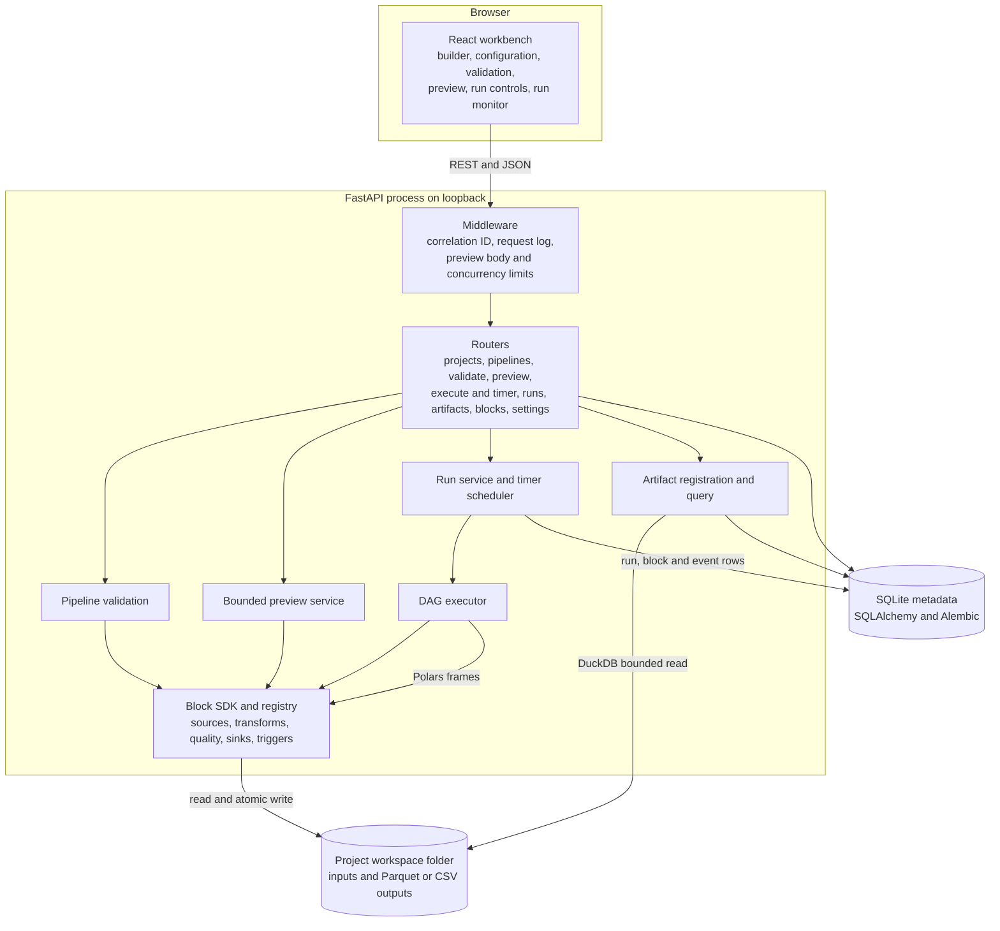
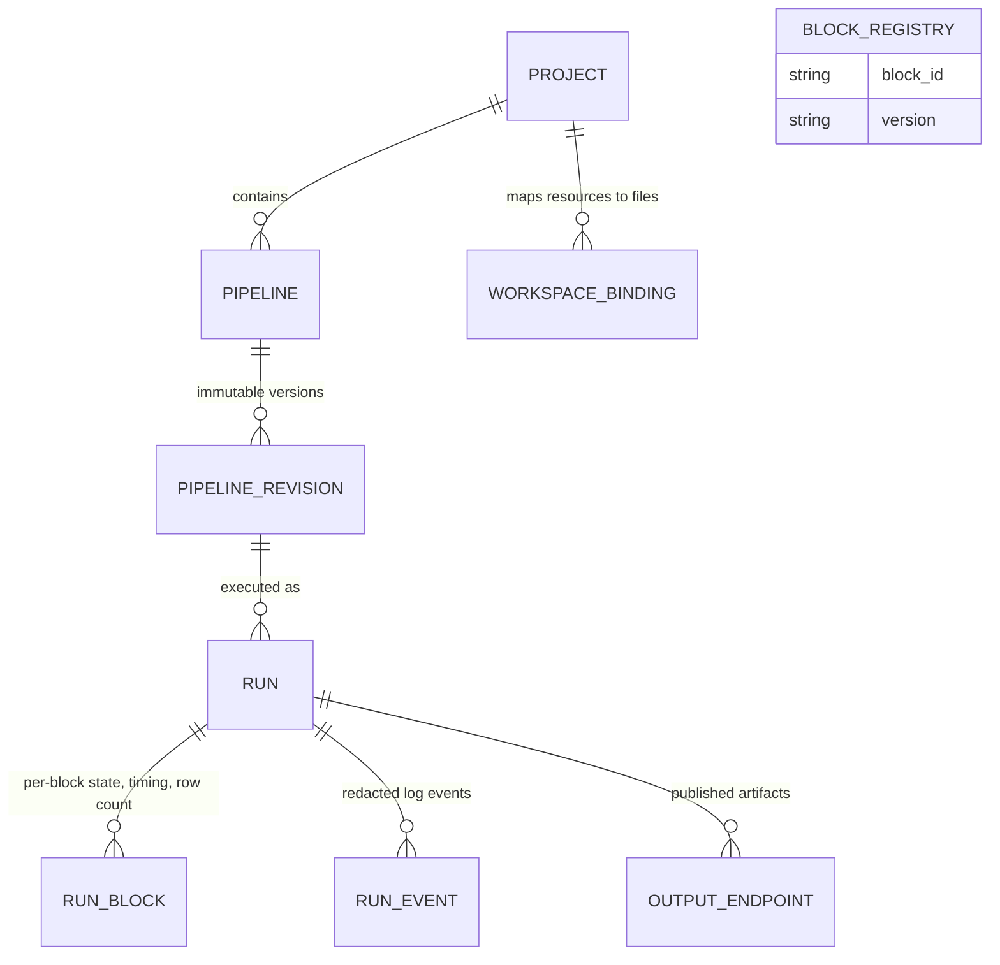
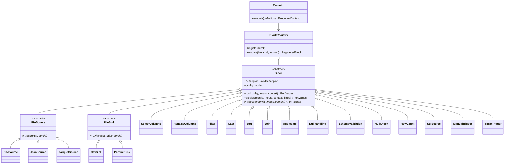
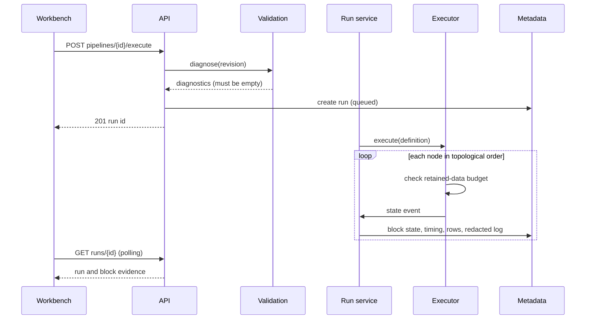

# Overall architecture and class diagrams

This page describes the system as implemented at Release 1.

## Guiding rule

**The UI authors definitions. The engine executes definitions.** The executor and the block SDK run without React or any UI state, so a pipeline can be validated and run headlessly from Python or through the API.

## High-level architecture

## Layers and where they live

| Layer | Responsibility | Code |
|---|---|---|
| Presentation | Workbench pages and panels | [frontend/src](https://github.com/ham340i/Industrial-Data-Pipelinen-Platform/blob/main/frontend/src/App.tsx) |
| Client state | Unsaved graph and selection (Zustand); server data (TanStack Query) | [frontend/src/state](https://github.com/ham340i/Industrial-Data-Pipelinen-Platform/blob/main/frontend/src/state/editor.ts) |
| API client | Typed requests and response parsers that reject malformed payloads | [frontend/src/api](https://github.com/ham340i/Industrial-Data-Pipelinen-Platform/blob/main/frontend/src/api/client.ts) |
| API | Routing, request validation, error envelope, middleware | [app/main.py](https://github.com/ham340i/Industrial-Data-Pipelinen-Platform/blob/main/app/main.py), `app/*/api.py` |
| Application services | Validation, preview planning, run recording, timers, artifact governance | [validation](https://github.com/ham340i/Industrial-Data-Pipelinen-Platform/blob/main/app/pipelines/validation.py), [preview](https://github.com/ham340i/Industrial-Data-Pipelinen-Platform/blob/main/app/preview/service.py), [runs](https://github.com/ham340i/Industrial-Data-Pipelinen-Platform/blob/main/app/runs/service.py), [artifacts](https://github.com/ham340i/Industrial-Data-Pipelinen-Platform/blob/main/app/artifacts/query.py) |
| Domain | Portable pipeline definition, block contracts, executor | [pipeline model](https://github.com/ham340i/Industrial-Data-Pipelinen-Platform/blob/main/app/pipelines/models.py), [block contracts](https://github.com/ham340i/Industrial-Data-Pipelinen-Platform/blob/main/app/blocks/contracts.py), [executor](https://github.com/ham340i/Industrial-Data-Pipelinen-Platform/blob/main/app/execution/runtime.py) |
| Blocks | One module per responsibility | [resources](https://github.com/ham340i/Industrial-Data-Pipelinen-Platform/blob/main/app/blocks/resources.py), [readers](https://github.com/ham340i/Industrial-Data-Pipelinen-Platform/blob/main/app/blocks/files.py), [sinks](https://github.com/ham340i/Industrial-Data-Pipelinen-Platform/blob/main/app/blocks/sinks.py), [transforms](https://github.com/ham340i/Industrial-Data-Pipelinen-Platform/blob/main/app/blocks/transforms.py), [join and aggregate](https://github.com/ham340i/Industrial-Data-Pipelinen-Platform/blob/main/app/blocks/relational.py), [quality](https://github.com/ham340i/Industrial-Data-Pipelinen-Platform/blob/main/app/blocks/quality.py), [SQL](https://github.com/ham340i/Industrial-Data-Pipelinen-Platform/blob/main/app/blocks/sql.py), [triggers](https://github.com/ham340i/Industrial-Data-Pipelinen-Platform/blob/main/app/blocks/triggers.py) |
| Persistence | Metadata models and migrations | [models](https://github.com/ham340i/Industrial-Data-Pipelinen-Platform/blob/main/app/metadata/models.py), [migrations](https://github.com/ham340i/Industrial-Data-Pipelinen-Platform/blob/main/migrations/versions) |

Dependencies point downward: API modules import services and domain; blocks never import the API, the executor or the database.

## Domain model (metadata)

A run always refers to an immutable pipeline revision, so run history stays meaningful after the pipeline is edited. An output is registered only after its file has been written successfully.

## Block SDK classes

`Block.run` is the single execution boundary: it validates configuration, checks every input and output against the declared port schemas, emits lifecycle events and converts any failure into a public `BlockError` that carries a code, never a stack trace or a data value.

## Run sequence

## Design decisions

Recorded as architecture decision records: [workbench shell](https://github.com/ham340i/Industrial-Data-Pipelinen-Platform/blob/main/docs/architecture/decisions/ADR-0001-workbench-shell.md), [SQLite metadata](https://github.com/ham340i/Industrial-Data-Pipelinen-Platform/blob/main/docs/architecture/decisions/ADR-0002-sqlite-metadata.md), [block SDK contract](https://github.com/ham340i/Industrial-Data-Pipelinen-Platform/blob/main/docs/architecture/decisions/ADR-0003-block-sdk-contract.md), [portable DAG](https://github.com/ham340i/Industrial-Data-Pipelinen-Platform/blob/main/docs/architecture/decisions/ADR-0004-portable-dag.md), [local projects](https://github.com/ham340i/Industrial-Data-Pipelinen-Platform/blob/main/docs/architecture/decisions/ADR-0005-local-projects.md).

Per-feature design notes: [local executor](https://github.com/ham340i/Industrial-Data-Pipelinen-Platform/blob/main/docs/architecture/local-executor.md), [graph validation](https://github.com/ham340i/Industrial-Data-Pipelinen-Platform/blob/main/docs/architecture/graph-validation.md), [selected-node preview](https://github.com/ham340i/Industrial-Data-Pipelinen-Platform/blob/main/docs/architecture/selected-node-preview.md), [run telemetry](https://github.com/ham340i/Industrial-Data-Pipelinen-Platform/blob/main/docs/architecture/run-telemetry.md), [triggers and execute](https://github.com/ham340i/Industrial-Data-Pipelinen-Platform/blob/main/docs/architecture/triggers-and-execute.md), [artifact governance](https://github.com/ham340i/Industrial-Data-Pipelinen-Platform/blob/main/docs/architecture/artifact-governance.md), [error recovery](https://github.com/ham340i/Industrial-Data-Pipelinen-Platform/blob/main/docs/architecture/error-recovery.md).

## Changes since the Release 1 target

- The file block module was split into resource configuration, readers, sinks and three bounded previews, and the transform module into row and column transforms and relational blocks. Behaviour is unchanged.
- Logging is configured in one place ([app/logging_config.py](https://github.com/ham340i/Industrial-Data-Pipelinen-Platform/blob/main/app/logging_config.py)).
