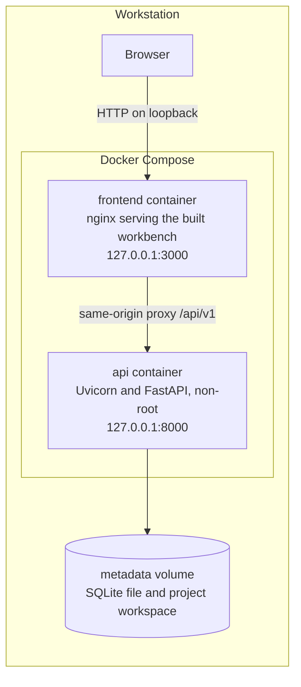

# Deployment plan and infrastructure

## Assumptions about users and usage

- One user per installation, on a Windows or Linux engineering workstation inside the partner's network.
- Data must not leave the workstation, so there is no hosted service and no cloud component.
- The user may not be able to install a database server or open network ports.
- Data volumes fit in workstation memory within the limits on the [Performance](https://github.com/ham340i/Industrial-Data-Pipelinen-Platform/wiki/Performance) page.

These assumptions come from the project brief. They have not been confirmed with the partner in writing; confirming them is an open action.

## Deployment diagram



Both ports are bound to loopback. Nothing listens on the network interface. The same application also runs without containers (Uvicorn plus the Vite build), which CI verifies on Ubuntu and Windows.

## How to deploy

```sh
cp .env.example .env
docker compose up --build --detach --wait
```

The API applies database migrations at start-up, so upgrading means pulling the new tag and starting again. `docker compose down` keeps data; `docker compose down --volumes` deletes it. Upgrade migrations are written to preserve existing run history. Rolling back to an older tag after a schema migration is not supported: back up the metadata file before upgrading ([test](https://github.com/ham340i/Industrial-Data-Pipelinen-Platform/blob/main/tests/test_metadata.py)).

## Release strategy

| Stage | Audience | Entry condition | Status |
|---|---|---|---|
| Stakeholder release | Partner contact, at each release signoff | Tagged commit, passing CI, demo on synthetic data | Not yet performed for Release 1 |
| Family and friends | People outside the team, synthetic data only | Stakeholder release done | Planned |
| Alpha | Partner's selected specialists on an approved workstation | Approved sample data and data contract | Planned for Release 2 |
| Beta | Wider set of partner users | Measured workloads, upgrade and backup tested | Planned for Release 3 |
| Full release | Partner-wide | Support owner, packaging and security review agreed | Plan only; handed to the partner |

Success criteria for the stakeholder release: a specialist builds a CSV to transform to Parquet pipeline, previews a step, runs it, sees the run evidence and queries the output, without help from the team.

## Deployment record

| Release | Tag | Environment | Date | Outcome |
|---|---|---|---|---|
| Release 1 | Not tagged yet | Local Docker Compose on a developer workstation | Pending | Pending |

No release has been deployed to the partner. When Release 1 is tagged, the GitHub Release records the tag, the environment, the date and the outcome, and this table is updated.

CI builds and starts the Compose stack on every pull request, which is the only deployment evidence so far ([ci.yml](https://github.com/ham340i/Industrial-Data-Pipelinen-Platform/blob/main/.github/workflows/ci.yml)).
